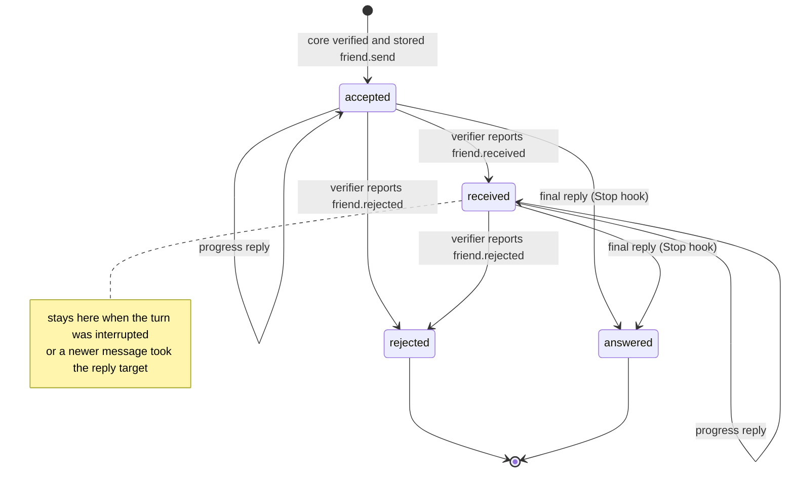

# Delivery states of an owner's message

States are delivery facts, not a task scheduler. A new message does not cancel or
close an earlier one; `answered` means a turn ended with a reply, not that the task is done.

`answered` and `rejected` are closed: a later reply to them is refused (`closed`).
With `[channel] match_prompt_id` a reply naming another prompt is refused and journalled
(`friend.reply.unmatched`). Historical `waiting` and `superseded` records (slice 3)
remain readable; a `waiting` message still accepts a reply.
