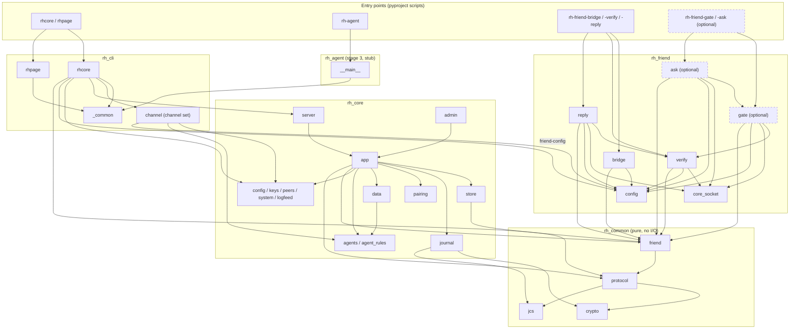

# Package dependencies

Static imports between packages in `src/`. Arrows point from the importer to what it uses.
Dashed boxes: the optional legacy gate (not part of a standard install).

Notes:

- `rh_common` is the only package shared by the core and the agent side; `rh_friend`
  never imports `rh_core` (it reaches a running core only over the admin socket and the
  inbox directory, see [runtime.md](runtime.md)).
- `reply` reuses the verifier's message note (`read_current`) and pending-reply queue.
- The CLI imports `rh_friend.config` only to write the agent-side config
  (`friend-config`, `channel set`).
