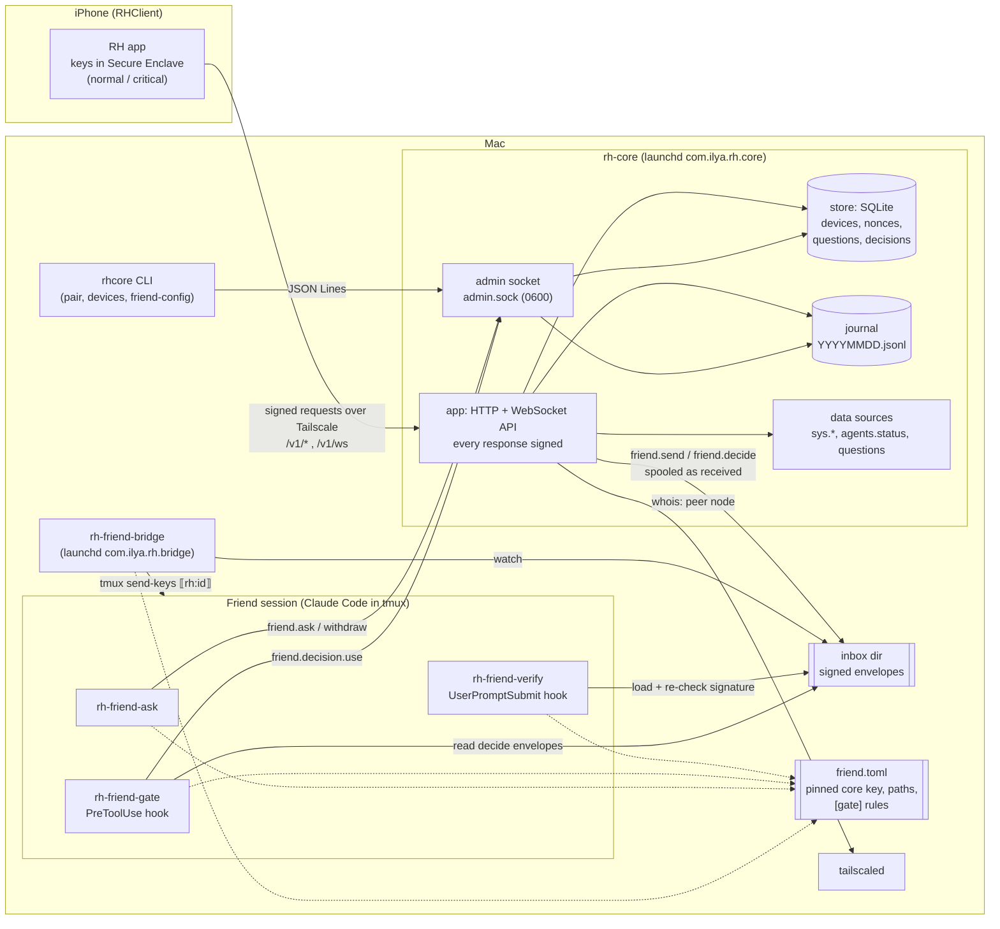

# Runtime view

The processes that run on the Mac, the phone, and the channels between them.

Trust notes:

- The core, the inbox and the bridge are transport. The Friend hooks check the phone's
  signature themselves against the device list signed by the pinned core key, so a broken
  transport can make a message fail, never pass.
- The admin socket only keeps state (questions, one-time spending of an allow); it does
  not vouch for signatures.
