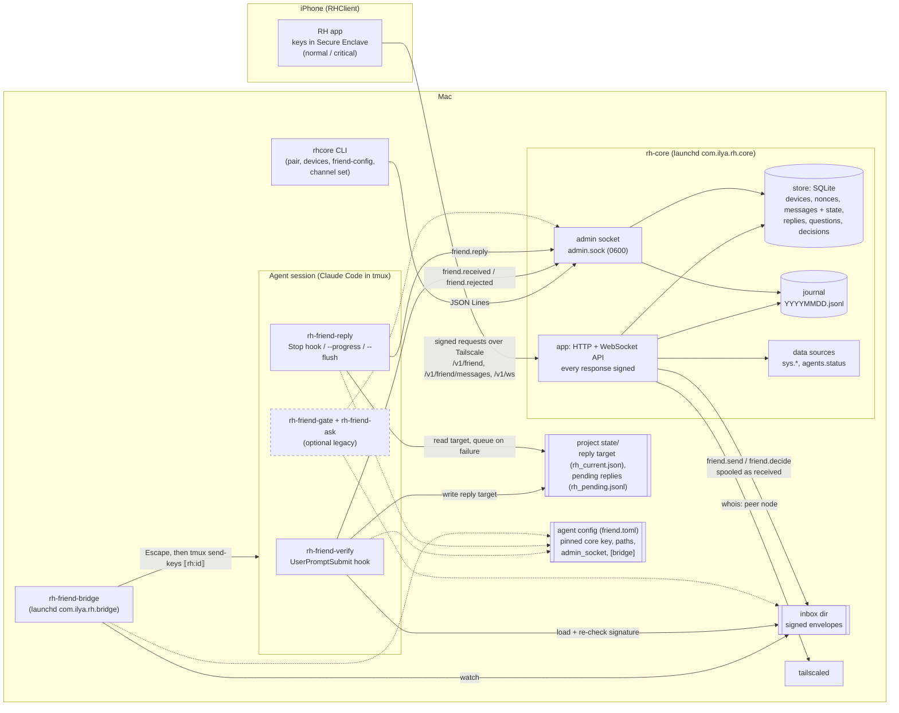

# Runtime view

The processes that run on the Mac, the phone, and the channels between them.
Dashed: the optional legacy gate (not part of a standard install).

Trust notes:

- The core, the inbox and the bridge are transport. The verifier checks the phone's
  signature itself against the device list signed by the pinned core key, so a broken
  transport can make a message fail, never pass.
- Replies are not signed: `friend.reply` over the admin socket is what the agent reports.
  The app says so ("states and replies are what Friend reports, not verified facts").
- Without the gate, what the agent may do is decided by its own permissions and
  instructions; RH adds no tool-call checks.
