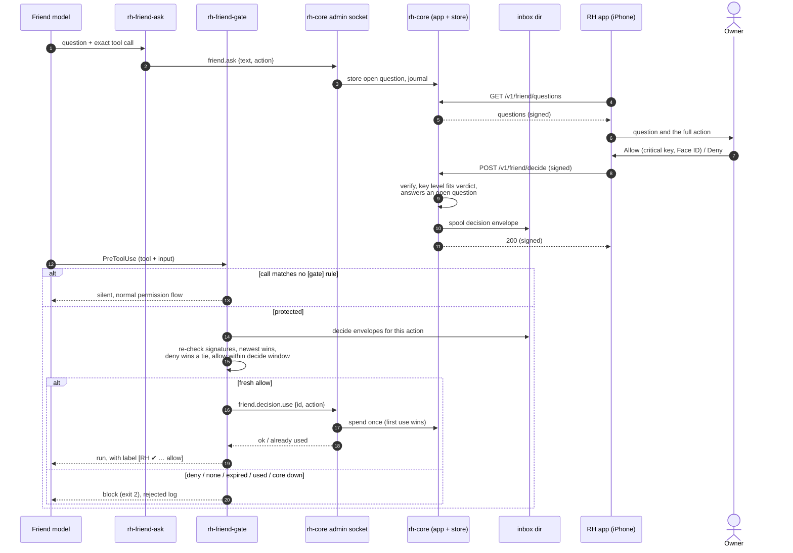

# Optional legacy gate: friend.ask / friend.decide

Not part of the standard channel. Only for an installation that explicitly adds the
`rh-friend-gate` PreToolUse hook ([friend-gate.md](../friend-gate.md)). It no longer
reads the message note: there is no question mode, only `[[gate.protected]]` rules.

